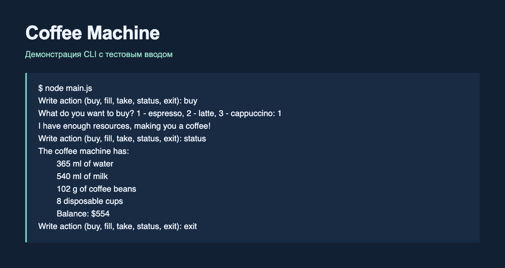
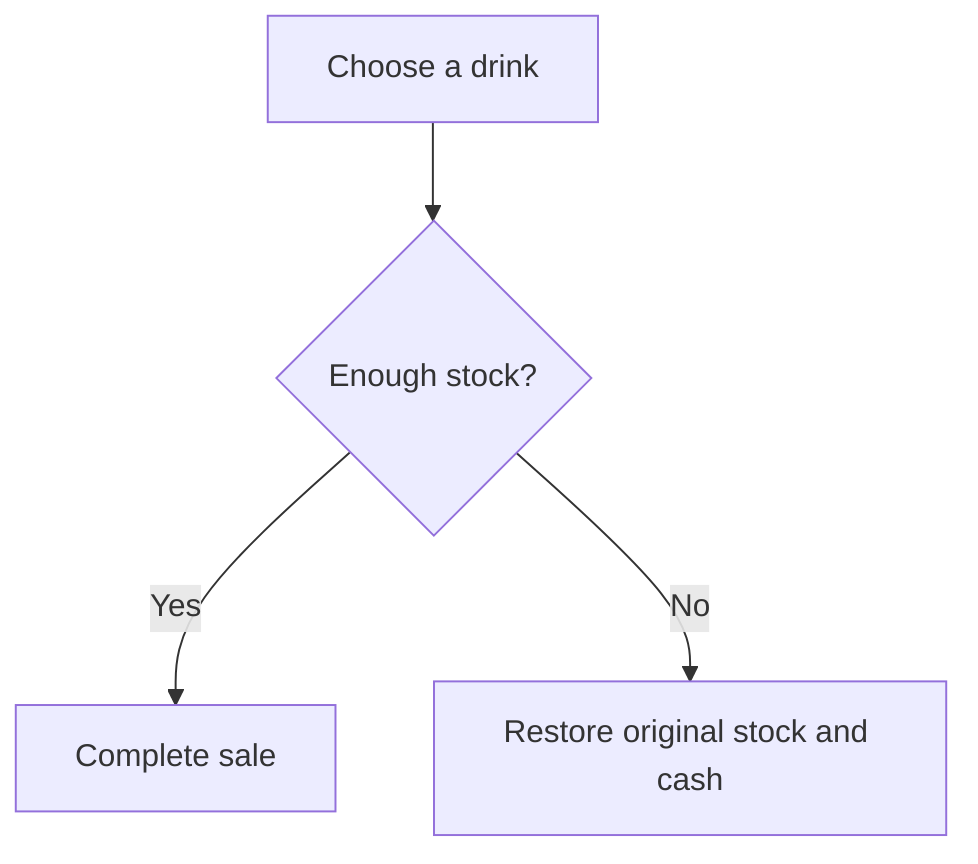

# Coffee Machine · JavaScript CLI

A terminal simulation of a coffee machine. It tracks ingredients and cash in memory, sells three drinks, and restores the previous balance and stock when a purchase fails.

[Demo](#demo) · [Repository map](#repository-map) · [PDF slides](docs/readme/overview.pdf) · [AGENTS.md](AGENTS.md)

## Demo



Local CLI run with scripted input. Buying one espresso raises the balance from $550 to $554.

1. Choose buy, then 1 for espresso.
2. Choose status to see $554 and 365 ml of water.
3. Choose exit to end the session.

## How it works



## Repository map

| File or directory | Purpose |
| --- | --- |
| [`main.js`](main.js) | Recipes, machine state and interactive commands |

## Run in a compatible environment

Use the educational runtime that supplies the `sync-input` module, then run `node main.js`. The public npm package currently has no installable version. For a standalone smoke check, run `node --check main.js`. The illustrated run uses an input stub for the four shown responses.

| Drink | Choice | Water | Milk | Coffee | Price |
| --- | --- | ---: | ---: | ---: | ---: |
| Espresso | 1 | 35 ml | 0 ml | 18 g | $4 |
| Latte | 2 | 35 ml | 215 ml | 18 g | $7 |
| Cappuccino | 3 | 35 ml | 145 ml | 18 g | $6 |

The `fill` and `take` actions use hardcoded exercise credentials. Each run starts with the same stock and cash.

## Milk per drink

Source: [recipes in main.js](main.js). Each solid block represents approximately 10 ml.

```text
Espresso                              0 ml
Latte       ██████████████████████  215 ml
Cappuccino  ███████████████         145 ml
```
